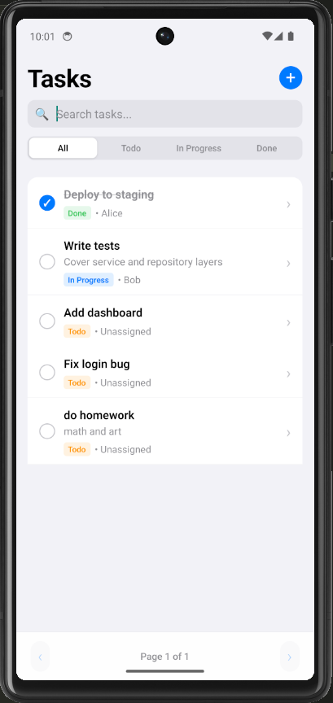
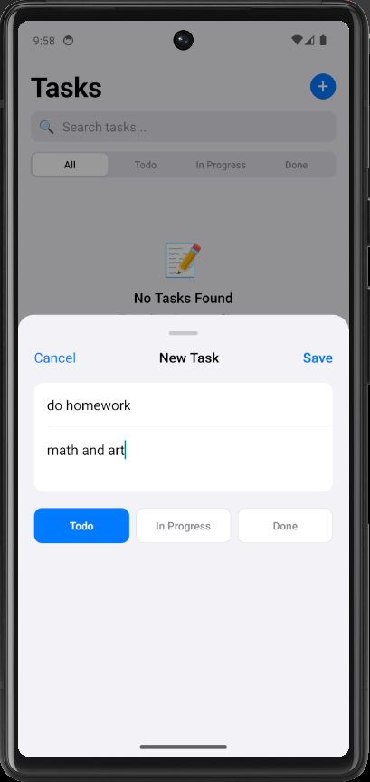
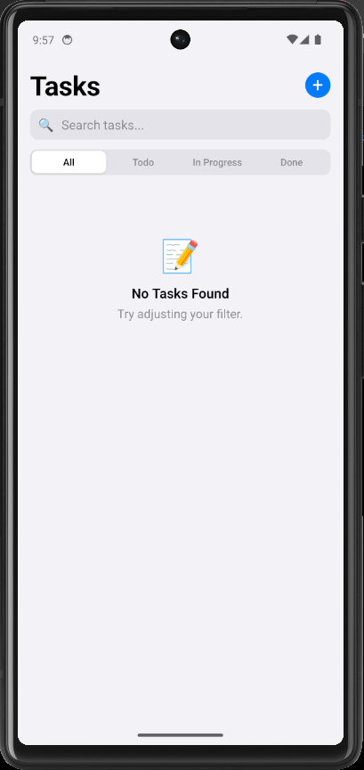

# Task Management Application - Fullstack Engineer Assessment

A full-stack Task Management application built to fulfill the Fullstack Engineer Assessment requirements.

The backend is built with **Go (Gin)**, **MySQL**, and **Redis** for caching. The frontend is built with **React Native (TypeScript)**, featuring an Apple Human Interface Guidelines (HIG)-inspired UI.

## ✨ Features Implemented

### Backend (Go + Gin)

- **RESTful API**: Full CRUD operations for tasks (`GET`, `POST`, `PUT`, `DELETE`).
- **Filtering & Pagination**: Support for `status`, `keyword`, `assignee`, `page`, `limit`, and `sort` query parameters.
- **Soft Delete**: Deleting a task updates `deleted_at` without removing the row; soft-deleted tasks are hidden from queries.
- **Consistent Errors**: Standardized JSON error responses (`400`, `404`, `409`, `500`). Duplicate task titles correctly return `409 Conflict`.
- **Redis Caching**: `GET /api/tasks` responses are cached for 60 seconds. Cache keys include all query parameters to prevent cross-contamination. Cache invalidates automatically on Create/Update/Delete.

### Frontend (React Native + TypeScript)

- **Apple HIG-Inspired UI**: Inset grouped lists, iOS Segmented Controls, frosted-glass bottom navigation, and native-feeling bottom sheets.
- **Live Search**: Debounced search input (300 ms) that resets pagination.
- **State Management**: Custom React hooks (`useTasks`) managing loading, error, and pagination states.
- **Add / Edit Modal**: Create and update tasks using a unified bottom sheet.
- **Loading States**: Skeleton shimmer rows for initial loads and inline spinners for form submissions.

---

## 🛠️ Tech Stack

| Layer              | Technology                                                 |
| :----------------- | :--------------------------------------------------------- |
| **Backend**        | Go (Gin), MySQL 8, Redis 7                                 |
| **Frontend**       | React Native, TypeScript                                   |
| **Testing**        | Jest, React Native Testing Library, `sqlmock`, `miniredis` |
| **Infrastructure** | Docker, Docker Compose                                     |

---

## 🚀 Getting Started

### Prerequisites

- [Docker Desktop](https://www.docker.com/products/docker-desktop/)
- [Go 1.21+](https://go.dev/dl/)
- [Node.js 20+](https://nodejs.org/)
- [Android Studio](https://developer.android.com/studio) (for Android Emulator)

### 1. Start the Infrastructure

From the repository root, start MySQL and Redis using Docker Compose:

```bash
docker compose up -d
```

> Wait approximately 10 seconds for MySQL to finish initializing before proceeding.

### 2. Initialize the Database

Run the migration to create the `tasks` table and its indexes.

**Windows PowerShell:**

```powershell
Get-Content backend\migrations\0001_init.up.sql | docker exec -i otoemdia_assesment-mysql-1 mysql -uroot -proot tasksdb
```

**macOS / Linux:**

```bash
cat backend/migrations/0001_init.up.sql | docker exec -i otoemdia_assesment-mysql-1 mysql -uroot -proot tasksdb
```

> If your Docker Compose project or MySQL container has a different name, replace `otoemdia_assesment-mysql-1` with the actual container name. You can find it with `docker ps`.

**Optional: Add sample data through the API**

```powershell
$body = @{
    title = "Fix login bug"
    description = "Users cannot log in"
    status = "todo"
    assignee = "alice"
} | ConvertTo-Json

Invoke-RestMethod -Uri http://localhost:8080/api/tasks -Method Post -Body $body -ContentType "application/json"
```

### 3. Run the Backend

Open a terminal:

```bash
cd backend
go mod tidy
go run ./cmd/server
```

The backend will run at `http://localhost:8080`.

### 4. Run the Frontend

Open another terminal:

```bash
cd OtomediaAssesment
npm install
npx react-native run-android
```

> The Android emulator is configured to connect to the backend through `http://10.0.2.2:8080/api`. The `10.0.2.2` address is the Android Emulator alias for the host machine's localhost.

---

## 📚 API Documentation

A manual API test suite is provided in **`backend/api.rest`**. Use the VS Code **REST Client** extension to run the requests directly from the editor.

### Endpoint Summary

| Method   | Endpoint         | Description                                              |
| :------- | :--------------- | :------------------------------------------------------- |
| `GET`    | `/health`        | Health check                                             |
| `GET`    | `/api/tasks`     | List tasks with filtering, pagination, and sorting       |
| `GET`    | `/api/tasks/:id` | Get a single task                                        |
| `POST`   | `/api/tasks`     | Create a task (returns `409` if the title is duplicated) |
| `PUT`    | `/api/tasks/:id` | Update an existing task                                  |
| `DELETE` | `/api/tasks/:id` | Soft-delete a task                                       |

### Query Parameters for `GET /api/tasks`

| Parameter  | Description                                            |
| :--------- | :----------------------------------------------------- |
| `status`   | Filter by status: `todo`, `in_progress`, or `done`     |
| `keyword`  | Search task title and description                      |
| `assignee` | Filter by exact assignee match                         |
| `page`     | Page number (default: `1`)                             |
| `limit`    | Number of records per page (default: `10`)             |
| `sort`     | Sort expression, e.g. `created_at:desc` or `title:asc` |

---

## 🧪 Testing

### Backend Tests

```bash
cd backend
go test ./... -v
```

The backend test suite covers repository SQL queries, service logic, duplicate-title conflicts, and Redis cache invalidation.

### Frontend Tests

```bash
cd OtomediaAssesment
npm test
```

The frontend test suite covers component rendering, debounced search, and status-filter interactions.

---

## 📱 App Screenshots

### 1. Task List & Search

Displays the task list, search input, and status filters.



### 2. Add / Edit Task Modal

Displays the bottom sheet with Cancel and Save actions and task form fields.



### 3. Empty & Loading States

Displays the loading skeleton and the empty-search state.



---

## 📂 Project Structure

```text
.
├── backend/                  # Go (Gin) REST API
│   ├── cmd/server/           # Application entry point
│   ├── internal/             # Handlers, services, repositories, Redis cache
│   ├── migrations/           # SQL schema and migrations
│   └── api.rest              # Manual API test suite
├── OtomediaAssesment/        # React Native (TypeScript) app
│   ├── src/
│   │   ├── api/              # API client / fetch wrappers
│   │   ├── components/       # UI components
│   │   ├── hooks/            # useTasks state management
│   │   └── screens/          # Screen composition
│   └── __tests__/            # Jest component tests
└── docker-compose.yml        # MySQL and Redis infrastructure
```

---

## 💡 Notes on Implementation

- **Concurrency & Duplicate Safety**: Duplicate active task titles are protected at the database level using a generated MySQL column (`active_flag`) and a `UNIQUE` index. This helps prevent race conditions when concurrent requests attempt to create tasks with the same title.
- **Cache Strategy**: Redis cache keys include normalized query parameters so different filter and pagination combinations do not share cached responses. Invalidation uses `SCAN` to find and delete `tasks:list:*` keys rather than the potentially blocking `KEYS *` command.
- **UI / UX**: The frontend uses standard Unicode symbols (such as `+`, `🔍`, and `›`) for selected UI affordances to avoid additional native icon-font linking requirements.

---
